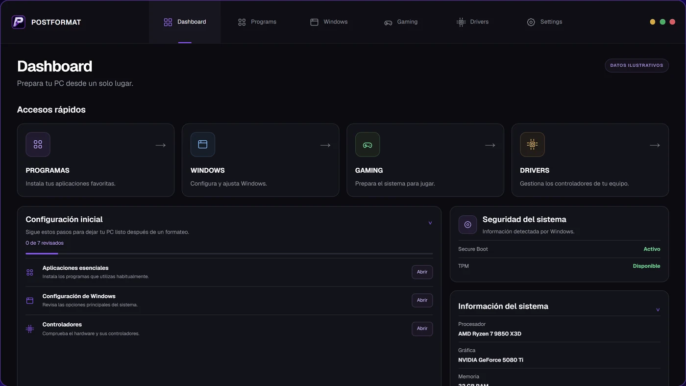

 

  

**[Qui sóc](#-qui-sóc) · [Pràctiques](#-pràctiques-fct) · [Estudis](#-què-estic-estudiant) · [Tecnologies](#%EF%B8%8F-competències-i-tecnologies) · [Projectes](#-projectes-personals) · [Objectius](#-objectius) · [Contacte](#-contacte)**

---

## 👤 Qui sóc

Em dic **Marc Bruguera** i tinc 17 anys. Curso **2n del CFGM de Sistemes
Microinformàtics i Xarxes** a l'Escola Pia de Mataró.

Compagino els estudis amb les pràctiques del cicle com a tècnic de helpdesk i
amb projectes propis centrats en l'optimització i la configuració de Windows.
[PENDENT: per què vas triar SMX i què és el que més t'agrada d'aquest món]

### 🔎 Tres coses més sobre mi

- 💼 Faig les pràctiques del cicle com a tècnic de helpdesk en una empresa de retail.
- 🤖 Estic construint una aplicació pròpia que fa servir IA per automatitzar la gestió d'inventari de l'empresa on faig les pràctiques.
- 🛠️ Desenvolupo eines per optimitzar i deixar a punt PCs amb Windows.

---

## 💼 Pràctiques (FCT)

Faig l'estada de pràctiques del cicle (FCT) en una empresa del sector retail.

### 🖥️ Tècnic de helpdesk en pràctiques · Empresa del sector retail

**Suport tècnic.** Atenc les incidències informàtiques del personal de l'empresa
com a tècnic de helpdesk.

**Gestió de l'inventari informàtic.** Porto tota la gestió de l'inventari
informàtic de l'empresa: tinc el control dels equips i de la informació que
se'n registra.

**Automatització amb IA.** Actualment estic automatitzant aquesta gestió
d'inventari amb IA. Per fer-ho, estic construint una aplicació pròpia que
m'ha de permetre reduir la feina manual i mantenir l'inventari al dia.

---

## 📚 Què estic estudiant

Actualment curso **2n d'SMX** a l'Escola Pia de Mataró i estic fent les
pràctiques (FCT) en una empresa del sector retail.

### 📦 Mòduls del cicle

| Mòdul | Què hi aprenc |
|---|---|
| Muntatge i manteniment d'equips | Components, acoblament i diagnòstic d'avaries |
| Sistemes operatius monolloc | Instal·lació i administració de Windows i Linux |
| Xarxes locals | Cablejat, adreçament IP, switching i configuració bàsica |
| Aplicacions ofimàtiques | Documentació tècnica, fulls de càlcul i Markdown |
| Seguretat informàtica | Còpies de seguretat, permisos i bones pràctiques |

### 🎯 Què vull aprendre

- [ ] Aprofundir en l'**automatització** amb PowerShell, Bash i Python
- [ ] Aplicar la **IA** a eines pràctiques, començant per la meva app d'inventari
- [ ] Fonaments de **ciberseguretat**: enduriment de sistemes i vulnerabilitats
- [ ] Crear una **ISO pròpia de Windows** optimitzada
- [ ] Decidir entre el grau superior de **DAM** o d'**ASIX**

---

## 🛠️ Competències i tecnologies

<table>
<tr>
<th>Sistemes operatius</th>
<th>Scripting i desenvolupament</th>
<th>Desenvolupament web</th>
<th>Eines</th>
</tr>
<tr>
<td align="center">
&nbsp;
</td>
<td align="center">
&nbsp;&nbsp;
</td>
<td align="center">
&nbsp;
</td>
<td align="center">
&nbsp;&nbsp;&nbsp;
</td>
</tr>
</table>

### 📊 On estic ara mateix (autoavaluació)

| Àmbit | Nivell |
|---|---|
| Sistemes operatius |  |
| Scripting |  |
| Hardware i manteniment |  |
| Xarxes |  |
| Ciberseguretat |  |

---

## 💻 Projectes personals

### Els meus projectes

| Projecte | Descripció | Tecnologies | Codi |
|---|---|---|---|
|  [GYP Optis](https://gypopti.com) | Projecte propi amb una part web per ajudar a optimitzar PCs per jugar | TypeScript · CSS | 🌐 Web pública · 🔒 Codi privat |
| Script d'optimització de Windows | Automatitza ajustos de rendiment del sistema, dels serveis i de les aplicacions | PowerShell | 🔒 Repositori privat |
|  [PostFormat](https://postformat.es) | Ajuda a configurar un PC just després de formatejar-lo: instal·lació i configuració de jocs i optimització de les aplicacions i els serveis de Windows | Python | 🌐 Web pública · 🔒 Codi privat |

### 📸 Captures

  
   
  Tauler principal de PostFormat: accessos ràpids i guia de configuració després d'un formateig.

### 🔜 Pròxim projecte

- [ ] Crear una **ISO pròpia de Windows** optimitzada.

---

## 🚀 Objectius

<table>
<tr>
<td width="33%" valign="top">

**⏱️ Curt termini**

Acabar el grau mitjà i aprofitar les pràctiques per consolidar l'experiència de helpdesk i gestió d'inventari.

</td>
<td width="33%" valign="top">

**📆 Mitjà termini**

Fer un grau superior. Dubto entre DAM i ASIX i encara no ho tinc decidit.

</td>
<td width="33%" valign="top">

**🎯 Llarg termini**

Hi ha dos camins que m'interessen: l'enginyeria d'IA i la ciberseguretat. Encara no he triat.

</td>
</tr>
</table>

---

## 📈 La meva activitat a GitHub

---

## 📫 Contacte

  

Gràcies per passar-hi! · Perfil fet amb Visual Studio Code, Markdown i Git · 2026

